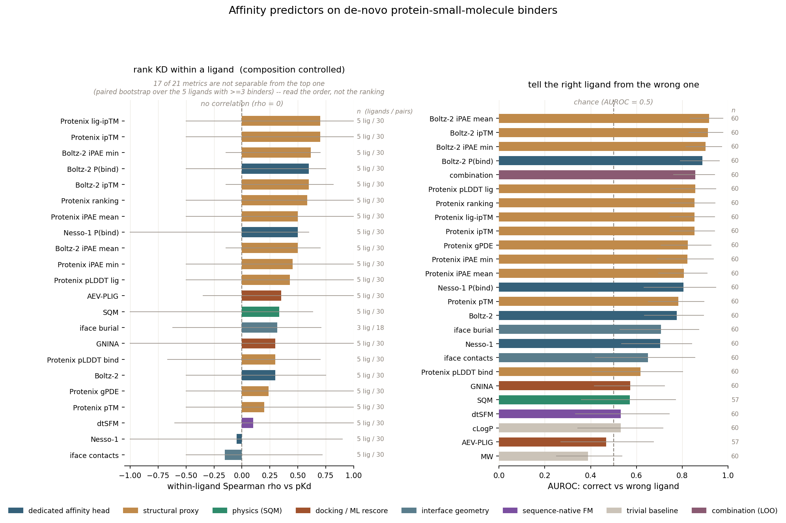

# de-novo small-molecule affinity benchmark

[](https://github.com/ssiddhantsharma/denovo-smallmol-affinity-benchmark/actions/workflows/ci.yml)

Do protein-ligand affinity predictors work on **de-novo designed** binders? Affinity leaderboards
score them on natural targets; this is a small complementary split built from published de-novo
designs.

**60 protein-ligand pairs:**
- **49 binders** with a measured KD (pKd).
- **11 confirmed non-binders**: 8 are a binder's protein paired with a *wrong* ligand, 3 are
  non-binding design variants. Either way a predictor has to read the interface, not the fold alone.

Affinity is ranked **within-ligand**: among the de-novo proteins that bind the *same* ligand, Spearman
of a metric against pKd, median across ligands (the analog of the within-target correlation used on
de-novo protein sets). This is reported rather than a pooled Spearman across all binders on purpose:
the set spans 19 ligands, and a pooled correlation is dominated by ligand composition (cLogP) instead
of the interface, so pooled numbers are a confound, not a result. A ligand-only score like cLogP is
constant within a ligand and drops out, which is the point. Classification (right vs wrong ligand) is
one AUROC over all 60. Cofolder affinity heads are converted to `pK = 6 - affinity_pred_value`.

## Results



Every metric, two panels: within-ligand rank-pKd (left, composition controlled; the dashed line is no
correlation, rho = 0) and right-vs-wrong-ligand AUROC (right; the dashed line is chance, 0.5). Bars
are 95% bootstrap CIs. `score.py` prints every number, including the pooled Spearman kept only for
transparency.

- **Within ligand, co-folder interface confidence leads.** Holding the molecule fixed (median over the
  5 ligands with >= 3 protein binders), the interface-confidence metrics come to the front: Protenix
  ipTM / lig-ipTM +0.70, Boltz-2 ipTM +0.60, Protenix pLDDT-ligand +0.43, interface-PAE in the same
  band. The physics and ML rescorers are middling (SQM +0.33, AEV-PLIG +0.35, GNINA +0.30) and the
  affinity heads trail (Boltz-2 +0.30, Nesso-1 -0.05). This is the same confidence family (iPTM, pTM,
  pLDDT, interface-PAE) that ranks KD on de-novo *protein* sets. CIs are very wide (only 5 ligand
  groups, 3 to 9 binders each), so the ordering is suggestive, not decisive.
- **Almost none of that ordering is statistically separable, and the table says so.** `score.py`
  runs a paired bootstrap over the ligands *both* metrics scored, and **18 of 21** metrics are not
  distinguishable from the top one. The only three the top metric beats with an interval clear of
  zero are Nesso-1 P(bind), SQM, and Nesso-1 -- and that is before correcting for 21 comparisons,
  so even those are weak. Read the left panel as a rough ordering of families, never as a ranking
  of individual metrics: "Protenix ipTM +0.70 beats Boltz-2 ipTM +0.60" is not a finding, it is
  two medians over the same five ligands.
- **Specificity also belongs to the co-folders.** On telling the correct ligand from the wrong one,
  the interface-confidence metrics lead: Boltz-2 / Protenix ipTM 0.85 to 0.91, Protenix pLDDT-ligand
  0.86, pTM 0.79. cLogP, dtSFM, and the physics/ML rescorers are near chance. A pure-geometry pose
  baseline, ligand burial (`interface-ligburial`, fraction of the ligand within 4.5 A of the protein),
  reaches 0.71, above cLogP, but carries no affinity-ranking signal that survives its interval
  (within-ligand rho +0.32 over only 3 ligands, CI [-0.62, +0.71]): the real ligand is more buried,
  yet burial does not demonstrably order KD.
- **A sequence-native affinity FM fails too; the failure is the data regime, not co-folding.**
  dtSFM (`dtsfm-cosine`), a 714k-pair drug-target specificity foundation model, is at chance on de
  novo (AUROC 0.53, within-ligand +0.10), yet its featurization validates on in-distribution natural
  pairs (true-vs-shuffled AUROC 0.863; `scripts/run_dtsfm.py` gates on that positive control first).

| task | best single | cLogP | combination (LOO) |
|---|---|---|---|
| rank pKd, within-ligand (median Spearman) | +0.70 | n/a (constant per ligand) | not defined |
| tell right from wrong ligand (AUROC) | 0.91 | 0.53 | 0.84 |

> **Corrected 2026-11-11.** The rank statistics broke ties by row order, which the
> `1 - 6*sum(d^2)/(n(n^2-1))` Spearman shortcut is not valid for. Five metrics carry ties
> (`interface-ligburial` 42 of 60, `interface-ncontacts`, `clogp`, `molecular-weight`,
> `rowan-aevplig`), so their numbers were wrong — most visibly `interface-ligburial`'s
> within-ligand rho, reported as +0.10 and actually **+0.32**. Ranks are midranks now and
> Spearman is Pearson-on-ranks, matching scipy to 1e-16 on tie-dense input. Nine of 68
> point estimates moved; no conclusion in this README changed.

## Caveats

**The within-ligand axis rests on far less data than "60 pairs" suggests.** Only 5 of the 19
ligands have the >= 3 protein binders a within-ligand rank needs, so that median is taken over
**5 ligands / 30 pairs** for most metrics (3 ligands / 18 pairs for `interface-ligburial`, which is
missing some poses). The figure prints that n beside every bar and `score.py` prints it as `n_lig`
and `n_pairs`, because a bar without its n reads as a ranking. The other 14 ligands contribute to
the AUROC panel (all 60 pairs) but not to the affinity panel.

Small n (49 + 11): CIs are wide and orderings are suggestive. The 11 negatives are confirmed
non-binders from a handful of designed proteins. This small n reflects the field, not the search: a
systematic survey of the de novo literature turns up essentially no further designed binders of
*organic* small molecules with a precise measured KD. The remaining de novo binders are
metallo-cofactor systems (heme, Zn-porphyrin, Zn-chlorophyll maquettes) or designed pockets grafted
onto natural scaffolds, so the set is close to the available universe rather than a sample of it. The
three cofolders share the AF3-style family, so they are not independent. Cofolder metrics carry
run-to-run diffusion-sampling variation, and on this set that is **measured, not estimated**: see
"Re-folding moves these numbers" below. An earlier version of this file guessed "~0.05 Spearman";
the real figure reaches **0.26**.
Positive KDs come from mixed assays and are not cross-calibrated.

## Methods scored

Every predictor is a third-party model or tool; this repo only wires it to the split, converts its
outputs to a common convention, and scores it. Full citations are in [References](#references);
please cite the original work when using any result here.

| column(s) | method | family | reference |
|---|---|---|---|
| `boltz-2`, `boltz-2-pbind`, `boltz-2-iptm`, `boltz-2-pae-{min,mean}` | Boltz-2 (affinity head + confidence) | co-folding | Passaro et al. 2025 |
| `nesso-1`, `nesso-1-pbind` | Nesso-1 (affinity head) | co-folding | Recursion / Valence Labs |
| `protenix-{iptm,ligiptm,ptm,plddt-binder,plddt-ligand,gpde,ranking,pae-min,pae-mean}` | Protenix v2 (confidence + ranking) | co-folding | ByteDance AML 2025 |
| `dtsfm-cosine` | dtSFM encoder cosine (drug-target specificity FM) | sequence-native FM | dtSFM-v3, BIIE ETH Zürich |
| `clogp`, `molecular-weight` | Crippen cLogP, molecular weight | physicochemical baseline | RDKit |
| `rowan-sqm`, `rowan-gnina`, `rowan-aevplig` | SQM (PM6-D3H4X/COSMO2), GNINA, AEV-PLIG | physics / docking / ML rescoring | via Rowan |
| `rowan-boltz-2-{affinity,pbind,iptm}` | Boltz-2 hosted end to end (sequence + SMILES in, no GPU) | co-folding | via Rowan |
| `interface-ncontacts`, `interface-ligburial` | protein-ligand contacts and ligand burial from the pose | interface geometry | `scripts/run_interface.py` (gemmi) |

The confidence metrics cover the de-novo metric set used on protein binders (iPTM, pTM, pLDDT,
interface-PAE, contacts). ipSAE, ipDAE and LIS, the strongest there, are protein-protein scores
built from the full residue-residue PAE matrix. Which of them is available depends on the folder,
and an earlier version of this README wrongly said the matrix "was not saved here" across the
board:

| folder | full residue-residue PAE | consequence |
|---|---|---|
| Boltz-2 | **saved** (`--write_full_pae`) | ipDAE is computable with no GPU -- `scripts/run_ipdae.py` |
| Protenix | not saved, only `chain_pair_pae_{min,mean}` | ipSAE/ipDAE/LIS would need a re-fold |

For a few-atom ligand the natural analog of these scores is lig-ipTM plus interface-PAE, which are
included for both folders.

De-novo designs and labels are from the papers cited per row (`source`, `source_url`) in
`reference/system_reference.csv`.

## Re-folding moves these numbers (and the published ones were irreproducible)

The Protenix predictions were re-derived from the folds that still exist (`_work/px_out`, seed 101,
5 diffusion samples per system, averaged). They did not reproduce what was committed. The committed
values came from an **earlier fold that no longer exists**: regenerating from the surviving outputs
matches the current files to 0.000000 and the previously published ones only to 0.036.

Worse, the committed set was **mixing two folds**: `protenix-ptm`, both pLDDT columns and both
interface-geometry columns regenerated byte-identical (they were derived later, from the surviving
fold), while `protenix-{iptm,ligiptm,gpde,ranking,pae-*}` did not. The figure was comparing metrics
from fold A against metrics from fold B.

Everything Protenix-derived is now regenerated from the one surviving fold, so the numbers follow
from data in hand via `python scripts/run_predictors.py protenix-parse` (no GPU). What that cost:

| metric | published | surviving fold | delta |
|---|---|---|---|
| `protenix-gpde` | +0.50 | **+0.24** | **-0.26** |
| `protenix-ranking` | +0.47 | +0.58 | +0.11 |
| `protenix-pae-min` | +0.52 | +0.45 | -0.07 |
| `protenix-iptm` / `-ligiptm` | +0.65 | +0.70 | +0.05 |

**This is the single most useful thing in the benchmark.** Re-running the *same model at the same
seed* moves a within-ligand median by up to **0.26** — larger than almost every gap in the ranking
it is used to justify. It is an independent confirmation of the separability result above: when one
re-fold can move a metric by 0.26, an ordering whose neighbours differ by 0.03-0.15 is noise. Treat
any single-fold affinity benchmark number, here or elsewhere, as carrying error bars of this size
whether or not they are drawn. The best metric is unchanged (`protenix-iptm`), 18 of 21 metrics
remain non-separable from it, and the AUROC panel barely moves.

The Boltz-2 and Nesso-1 columns are untouched: their outputs are gone, so they could not be
re-derived and were not re-run. Those columns are still from their original single fold.

## ipDAE: implemented, not yet run

`scripts/run_ipdae.py` ports BindCraft2's `i_pDAE` to a protein-ligand interface and writes
`boltz-2-ipdae`. The math is unit-tested; **it has not been run against the real folds**, because
`_work/` is gitignored and the Boltz-2 outputs live on the box that did the folding. Nothing in the
results above includes it. Two things worth knowing before reading anything into it when it does
run:

- **Contact is heavy-atom at 4.5 Å, not CA-CA at 8 Å.** A ligand has no CA. This matches the
  definition `run_interface.py` already uses, so the metrics agree on what the interface is.
- **d0 saturates, so ipDAE is less novel here than on a protein interface.** Its partner-count
  scale only exceeds 1.0 at **27+ partners** (verified numerically, pinned by a test). A ligand
  atom never contacts 27 residues, so d0 pins to 1.0 and the score reduces to the max over anchors
  of mean `1/(1+PAE²)`. That is not a monotone transform of mean interface PAE -- the nonlinearity
  comes before the average and the max picks one anchor -- but it reads the same matrix as
  `boltz-2-pae-{min,mean}`, which are already here at within-ligand +0.62 / +0.50. Given that 18 of
  21 metrics are already not separable from the top one, expect ipDAE to land inside that same
  blob rather than to add an independent axis. `--report` prints the measured fraction of anchors
  with d0 > 1 so this is checked, not assumed.

The script refuses to guess: it fails loudly if the structure's residue count disagrees with the
sequence, or if the PAE token count is not `len(protein) + n_ligand_heavy_atoms`. Boltz-2's PAE is
paired with Boltz-2's own structure -- crossing it with the Protenix pose that `run_interface.py`
reads would score one model's confidence against another model's coordinates.

## Rowan physics / docking rescoring

The open question this split raises, *does any method actually track KD on de-novo binders, or does
that only work on natural complexes?*, is probed with [Rowan](https://docs.rowansci.com)'s
binding-affinity workflow over scorer families that are not co-folding heads. Each scores a bound
pose (the best-ranked of Protenix v2's 5 samples per system), fed to Rowan through the
[`rowan-python`](https://github.com/rowansci/rowan-python) SDK in its apo-protein + external-pose
mode; SQM additionally runs a protonation (protein-preparation) step first. Wiring is in
`scripts/run_rowan.py`.

- **Physics (SQM) is middling once the ligand is controlled.** Within-ligand, SQM is +0.33, below the
  interface-confidence metrics (ipTM ~0.7). On the confounded pooled Spearman it reaches +0.40, which
  an earlier version of this README over-read as a physics win; that edge was ligand composition, the
  same thing cLogP reads, not the interface.
- **The learned rescorers do not stand out either.** GNINA (within-ligand +0.30) and AEV-PLIG
  (+0.35), both trained on natural complexes (PDBbind-style), stay middling.
- **None of the three help with specificity.** On telling the correct ligand from the wrong one, SQM
  (0.57), GNINA (0.58), and AEV-PLIG (0.47) are all near chance, far below co-folder ipTM (0.91).

So physics and docking rescoring do not beat the co-folders' own interface-confidence metrics here;
the honest read is that nothing in this family clears the bar that ipTM already sets within-ligand.

Caveats: SQM's truncated-pocket energies are noisy (cut salt bridges leave some pockets
electrostatically incomplete). Neither SQM nor AEV-PLIG can score the three silicon-rhodamine dye
systems (COSMO2 has no Si parameters; AEV-PLIG rejects the Si poses), so those cells are blank; GNINA
scores all 60.

## Layout

```
reference/experimental_reference_ground_truth.csv   id, is_binder, experimental_pKD
reference/system_reference.csv                       id, protein, ligand_name, sequence, smiles, source, source_url
predictions/<method>_predictions.csv                 method, id, predicted_affinity
reference/source_watermarks.json                     what the weekly watcher has already seen
reference/rowan_cofold_workflows.json                hosted run -> workflow id + credits charged
scripts/score.py, scripts/make_figure.py             the statistics, and the figure
scripts/methods.py                                   registry: every column, its producer, its category
scripts/qc_dataset.py                                21 integrity checks, run on every PR
scripts/check_sources.py                             the watcher: one Europe PMC query, no model
scripts/append_paper.py                              the only thing that writes reference/
scripts/run_rowan.py                                 pose-based rescoring (SQM/GNINA/AEV-PLIG)
scripts/run_rowan_cofold.py                          hosted co-folding, no GPU, budget ledger
scripts/update.py                                    the GPU+Rowan half, dry-run by default
.claude/agents, .claude/skills                       the extract/verify agents and the skill
```

Every `predictions/*.csv` joins to the reference by `id` and is scored automatically.

## Growing the set

The benchmark is small because the field is: de-novo designed proteins with a *measured*
affinity for a small molecule are a few papers a year. The loop that grows it:

1. **`weekly`** opens an issue listing new candidate papers.
2. **You** run the `add-smallmol-paper` skill — extract, verify, `append_paper.py` — and open a PR.
3. **`qc`** checks the PR; you merge.
4. **`rowan`** scores the new rows; **`figures`** redraws.

See [GitHub Actions](#github-actions) for what each one does and what it costs.

**Step 2 is deliberately not automated.** Extraction is a model reading a PDF, and the
property that makes this set worth citing is that no model has ever written `reference/` —
only `append_paper.py` does. A wrong row is worse than a missing one, because nobody can
tell which rows to distrust. So the chain stops at a PR and a human merges; the weekly job
only *scores* rows that a human already merged.

**The query favours precision.** `"de novo" AND "small molecule"` is dominated by the
opposite problem — designing a *drug* against a natural protein — at about 2 useful hits in
23. Requiring the designed thing to be the protein gives 5 hits over three years of which 2
are real; adding biosensor terms for recall brought back SPR instruments and imprinted
polymers. Recall is the weak side on purpose: treat the issue as a reading list.

### Scoring

No GPU needed. Rowan's co-folding takes a sequence and a SMILES, folds server-side and
returns Boltz-2's affinity head with it:

```
gh secret set ROWAN_API_KEY                                     # once
gh workflow run rowan                                           # draft: validates, free
gh workflow run rowan -f draft=false -f max_systems=2 -f max_credits=50
gh workflow run rowan -f action=collect
```

Or locally: `python scripts/run_rowan_cofold.py --submit --max-credits 50 --max-systems 5`.

Columns are named `rowan-<model>-{affinity,pbind,iptm}`, and **the model is in the name
deliberately**: `--model` is a dispatch input, so a fixed name would have let a Chai-1r run
overwrite Boltz-2's numbers in place. They are also **separate from the local `boltz-2*`
columns and must stay separate** — same model family, different deployment and MSA server.

Measured cost is **9.1–9.4 credits per system**, so all 60 is roughly 560. Read it only
from a finished workflow: `credits_charged` grows while a run is in flight, and an early
read of 3.06 is how the first estimate came out three times too low.

On the two systems scored so far, hosted Boltz-2 reproduces our local Boltz-2 closely —
pK 5.81 vs 5.56 and 7.11 vs 7.44, iPTM within 0.004. That is a useful check on the hosted
path and also the reason finishing this column is low value: **a model we have no local
copy of is what the credits are for.** SQM, GNINA, AEV-PLIG and NESSO are already scored
at full coverage by the pose-based path below, so they are not that either.

The GPU is still needed for the *pose-based* rescorers (SQM, GNINA, AEV-PLIG), which take a
pose rather than a sequence; `scripts/update.py` drives that path.

After appending, new rows are in no figure until they are scored. `qc_dataset.py` reports
partial coverage as a **warning** naming the method and the count — it does not fail, so a
hosted run that is still landing does not hold the repo red. Ids that are *not* in the
reference do fail: that is always a bug, never a run in flight.

## GitHub Actions

Six workflows. Only one can spend money.

| workflow | trigger | does | cost |
|---|---|---|---|
| `ci` | push, PR | `ruff check scripts tests`, then `pytest` | free |
| `qc` | PR touching `reference/`, `predictions/`, `qc_dataset.py` | 21 integrity checks; row-count floor read from the PR base branch | free |
| `figures` | push touching `predictions/`, `reference/`, `score.py`, `make_figure.py` | re-score, redraw `figures/benchmark.png`, commit it | free |
| `watch-sources` | `workflow_call`, dispatch | one Europe PMC query against a committed watermark; opens one issue. No model, no key, **cannot write `reference/`** | free |
| `weekly` | Monday 09:00 UTC, dispatch | calls `watch-sources`, then **submits up to 5 hosted systems** | **~46 credits/week** |
| `rowan` | dispatch only | submit or collect hosted co-folding, larger batches | credits |

Public repo, so Actions minutes are free; the only real cost is Rowan credits.

**What bounds the spending.** Three things, because the first two do not bound a session:

- `--max-credits` caps one Rowan workflow. Rowan's own cap is per workflow, so this alone
  bounds nothing larger.
- `--max-systems` caps one run. Neither of these stops someone dispatching ten times.
- `BUDGET_CREDITS` in `run_rowan_cofold.py` is a ceiling on the **cumulative** charge. It
  reads the committed ledger in `reference/rowan_cofold_workflows.json` and refuses to
  submit past it. A recorded workflow whose charge has not been collected yet counts at the
  measured rate rather than as free, so an uncollected run is never invisible to it.

**`weekly` does spend unattended** — about 5 systems, ~46 credits, every Monday, with
nobody watching. That is deliberate and it is what `BUDGET_CREDITS` exists to bound. Set
**Max credit overage** in the Rowan dashboard too; it defaults to unlimited, there is no
billing API, and it is the only thing that can stop spend this repo does not know about.

**Key safety.** The key lives in one repository secret and is never printed — the workflow
logs its length, not its value. `rowan.yml` is `workflow_dispatch`-only, which GitHub
restricts to write access. Fork pull requests never receive repository secrets, and no
workflow here uses `pull_request_target`, the trigger that would hand a fork's code the
key. Dispatch inputs are passed through the environment rather than interpolated into a
shell command. `draft` defaults to **true**: the first run of any change validates the whole
submission path, executes nothing and costs nothing.

## Reproduce

```
# each cofolder needs its own GPU env; baselines are RDKit
CUDA_VISIBLE_DEVICES=0 BOLTZ=/path/to/boltz            python scripts/run_predictors.py boltz
CUDA_VISIBLE_DEVICES=0 NESSO=/path/to/nesso            python scripts/run_predictors.py nesso
CUDA_VISIBLE_DEVICES=0 PROTENIX_DIR=/path/to/Protenix  python scripts/run_predictors.py protenix
python scripts/run_predictors.py baselines
python scripts/run_predictors.py protenix-parse  # re-score a saved Protenix fold, no GPU
python scripts/run_ipdae.py --report   # ipDAE from the saved Boltz-2 PAE; needs _work/boltz_out
python scripts/score.py
python scripts/make_figure.py

# Rowan physics/docking rescoring (needs Protenix poses in _work/px_out + a ROWAN_API_KEY)
python scripts/run_rowan.py                       # dry run: split poses, print the plan
ROWAN_API_KEY=... python scripts/run_rowan.py --submit --methods sqm,gnina,aevplig --max-credits 300
```

## References

Models and scorers:

- **Boltz-2**: Passaro, Corso, Wohlwend, et al. *Boltz-2: Towards Accurate and Efficient Binding
  Affinity Prediction.* bioRxiv (2025). Code: [jwohlwend/boltz](https://github.com/jwohlwend/boltz).
- **Nesso-1**: Recursion / Valence Labs. *Nesso-1* technical report and model card:
  [recursionpharma/nesso](https://huggingface.co/recursionpharma/nesso).
- **Protenix v2**: ByteDance AML AI4Science Team (Chen et al.). *Protenix: Advancing Structure
  Prediction Through a Comprehensive AlphaFold3 Reproduction.* bioRxiv (2025),
  [doi:10.1101/2025.01.08.631967](https://doi.org/10.1101/2025.01.08.631967).
- **dtSFM**: Specificity Foundation Model, BIIE, ETH Zürich. Weights
  [SFM-BIIE-ETHZ/dtSFM-v3](https://huggingface.co/SFM-BIIE-ETHZ/dtSFM-v3); features from MoLFormer-XL
  (Ross et al., *Nat. Mach. Intell.* 2022) and ESM2 (Lin et al., *Science* 2023).
- **GNINA**: McNutt, Francoeur, Aggarwal, et al. *GNINA 1.0: molecular docking with deep learning.*
  *J. Cheminform.* 13, 43 (2021). Code: [gnina/gnina](https://github.com/gnina/gnina).
- **AEV-PLIG**: Valsson, Warren, Deane, Magarkar, Morris, Biggin. *Narrowing the gap between machine
  learning scoring functions and free energy perturbation using augmented data.* (2025),
  [PMC11807228](https://www.ncbi.nlm.nih.gov/pmc/articles/PMC11807228/).
- **SQM (PM6)**: Stewart. *Optimization of parameters for semiempirical methods V.* *J. Mol. Model.*
  13, 1173 (2007). Run via Rowan as PM6-D3H4X with COSMO2 solvation.

Software:

- **rowan-python** SDK: Rowan Scientific,
  [rowansci/rowan-python](https://github.com/rowansci/rowan-python).
- **RDKit**: Landrum et al. *RDKit: Open-source cheminformatics*, [rdkit.org](https://www.rdkit.org).
- **gemmi**: Wojdyr. *GEMMI: A library for structural biology.* *J. Open Source Softw.* 7, 4200 (2022).
- **scikit-learn**: Pedregosa et al. *Scikit-learn: Machine Learning in Python.* *JMLR* 12, 2825 (2011).
- **NumPy**: Harris et al. *Array programming with NumPy.* *Nature* 585, 357 (2020).
- **Matplotlib**: Hunter. *Matplotlib: A 2D graphics environment.* *Comput. Sci. Eng.* 9, 90 (2007).

## Acknowledgements

The physics/docking rescoring is made possible by compute credits generously provided by
[Rowan Scientific](https://rowansci.com) ([@RowanSci](https://x.com/RowanSci)), with thanks to
[Corin Wagen](https://x.com/cwagen) for the credits. See [References](#references) for the models,
scorers, and libraries this benchmark builds on.
